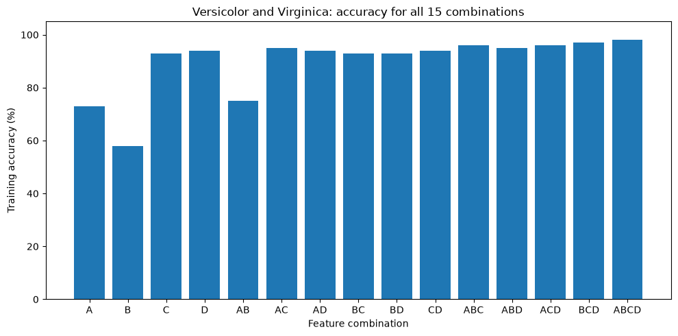
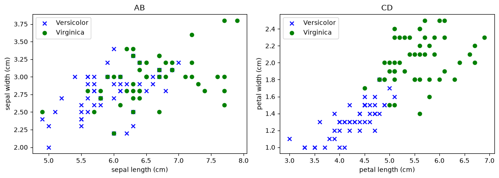

# Assignment 2 — Karl Savinskiy

The goal is to compare Versicolor and Virginica using every possible combination of the four Iris features. There are 15 combinations: four single features, six pairs, four triples, and one using all four features.

Following the assignment instructions, each model is trained and scored on all 100 flowers from these two species. There is no training/test split.

## Method

Lecture 6 shows how to train a model with `SGDClassifier.fit()` and calculate accuracy with `.score()`. The same steps are repeated here for each feature combination.

I use log loss, which gives a linear logistic classifier. Training adjusts the weights to reduce this loss; the accuracy reported below is the fraction of flowers classified correctly. L2 regularization penalizes large weights, as discussed in the regularization lecture.

Before fitting, I standardize each feature by subtracting its mean and dividing by its standard deviation. This helps gradient descent when features have different scales. Scaling is an extra preprocessing step beyond the basic lecture 6 example. Since the assignment uses all selected flowers for training, the scaler also uses all 100 flowers.

Every model uses the same settings. The adaptive learning rate starts at 0.01 and decreases when the loss stops improving. The iteration limit is 10,000, with a small stopping tolerance. A fixed random seed makes the experiment repeatable.

## Comparing the accuracies

A = sepal length, B = sepal width, C = petal length, D = petal width. The bar chart shows the same results as the table, grouped by the number of features.

The scatter plots below compare the two sepal features with the two petal features. The points show the measured flowers and their actual species, not model predictions.

## Discussion

Petal measurements work better than sepal measurements when used alone. Petal length (C) gives 93% accuracy and petal width (D) gives 94%, compared with 73% for sepal length (A) and 58% for sepal width (B). The scatter plots help explain this: the species overlap more in the sepal plot, while the petal plot shows clearer separation, although some overlap remains.

The best pair is AC, with 95% accuracy. Using just the two sepal features (AB) gives 75%, while the two petal features (CD) give 94%. This also shows that a sepal measurement can be useful together with a petal measurement, even though it is weaker on its own.

The best three-feature combination is BCD at 97%. All four features give the highest accuracy, 98%, which means 98 out of 100 flowers are classified correctly. These are the best results for the model settings used here, not a claim that no other settings could do better.

Adding a feature does not always improve accuracy. D alone gives 94%, while BD gives 93%. Also, C and BC both give 93%. The model minimizes a regularized loss rather than directly maximizing the number of correct predictions, so adding a feature does not guarantee a higher accuracy.

All these scores are training accuracies, as required by the assignment. They describe how well the models classify the flowers used to fit them. They do not tell us how accurately the models would classify new flowers.

## References

- Assignment_02_Instructions.docx: species, feature combinations, and evaluation requirements.
- ML 06 Adaline.pptx: gradient descent and the `SGDClassifier` fit/score workflow.
- ML 09 Regularization.pptx and ML 10 Loss functions.pptx: regularization and loss functions.

The modeling approach follows the supplied lecture example. AI assistance was used to simplify the code and draft explanations.
